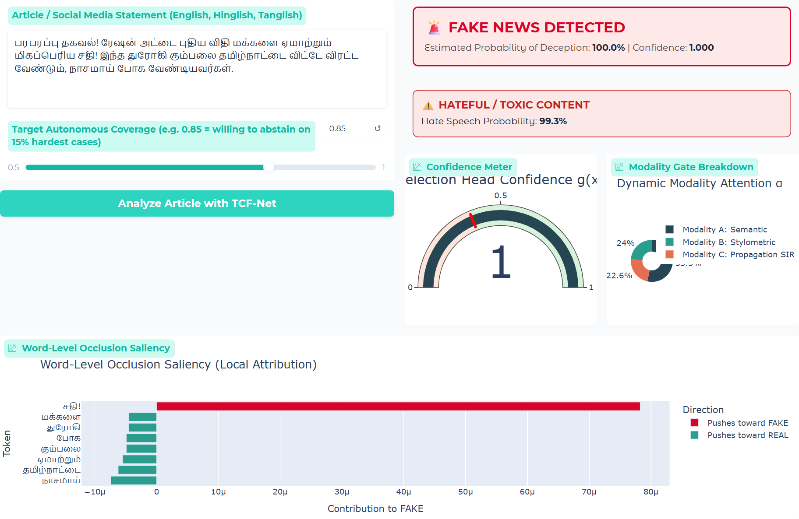
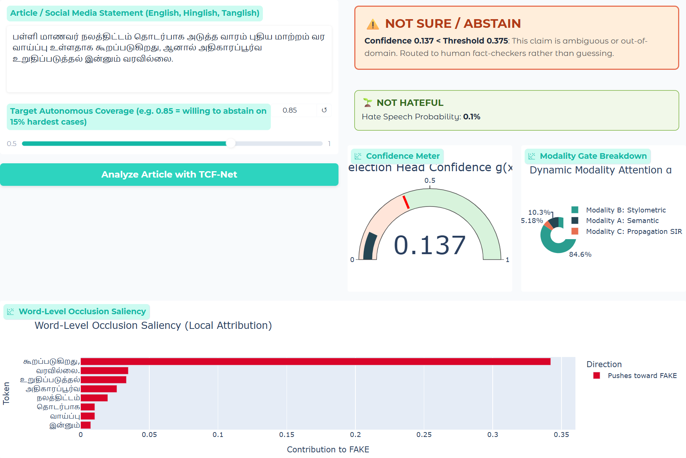

# TCF-Net: Tri-Modal Credibility Fusion Network

An explainable, selective fake-news detector for multilingual and code-mixed social-media text (English, Tamil,
Tamil–English "Tanglish", Hindi and Hindi–English "Hinglish"). It fuses three evidence streams (contextual semantics,
deception stylometry and a simulated propagation signal), answers **"Not Sure"** when a claim cannot be verified, and
detects **hate speech** in the same pass.

SWE1017 Natural Language Processing (EPJ), Slot A2 · Fall 2026–27 · Jayanithish B, Rohit S ·
Guide: Manjula V

---

## Architecture Overview

```
                      ┌──────────────────────────────────────────────┐
    Article Text ────▶│ Modality A: MuRIL / DistilBERT (768) + SVD   │──▶ Proj (256) ┐
                      └──────────────────────────────────────────────┘               │
                      ┌──────────────────────────────────────────────┐               │    ┌──────────────┐
    Raw Text     ────▶│ Modality B: 22-D Deception Stylometrics      │──▶ Proj (256) ┼───▶│ GATED FUSION │
                      └──────────────────────────────────────────────┘               │    │  (Softmax α) │
                      ┌──────────────────────────────────────────────┐               │    └──────┬───────┘
    Arousal Cues ────▶│ Modality C: 8-D SIR Cascade Simulator        │──▶ Proj (256) ┘           │
                      └──────────────────────────────────────────────┘                           ▼
                                                                                        Shared Trunk (256)
                                                        ┌────────────────────────────────────────┼───────────────────────────────────────┐
                                                        ▼                                        ▼                                       ▼
                                              Prediction Head f(x)                     Selection Head g(x)                      Hate Speech Head f_hate(x)
                                             (Real vs Fake Logits)                    (Confidence ∈ [0, 1])                    (Hateful vs Not Hateful)
```

### The Three Evidence Streams
1. **Modality A (Contextual Semantics):** Transformer encoder (`google/muril-base-cased` for code-mixed Indic text or `distilbert-base-uncased` for standard English) paired with a train-fitted `TruncatedSVD` lexical n-gram projection.
2. **Modality B (Stylometric Linguistics):** 22 hand-engineered features capturing deception markers: hedging density, sensationalism, superlatives, negations, pronoun ratios, punctuation burstiness, Flesch reading ease, and polarity.
3. **Modality C (SIR Cascade Diffusion Simulation):** A 24-step discrete-time Susceptible-Infected-Recovered simulation driven purely by text-derived arousal without seeing ground truth labels (guaranteeing zero data leakage).

### Cross-Modal Gated Fusion
* Computes dynamic, per-sample attention weights across streams: $\boldsymbol{\alpha} = \text{Softmax}(\text{MLP}([z_t; z_s; z_p])) \in \mathbb{R}^3$.
* Regularized with entropy penalty $- \beta H(\boldsymbol{\alpha})$ to prevent modal collapse.

### Selective Prediction (Abstention Mechanism)
* **SelectiveNet Policy:** If selection head confidence $g(x) < \tau$ (calibrated to target coverage, e.g. 85%), the system answers **"NOT SURE / ABSTAIN"** and delegates the claim to a human fact-checker rather than guessing.
* Evaluated via the **Selective Risk vs. Coverage curve** against random abstention.

---

## Results (held-out test set, grouped split)

Trained with `python train.py` on the 5,000-claim, 5-language benchmark (`data/tcf_multitask_dataset.csv`) using MuRIL.
The grouped split keeps every copy of a text inside one split (3,371 train / 630 val / 999 test).

| Metric | Value |
|---|---|
| Veracity accuracy, answering every claim | **92.29%** (macro-F1 0.9225, ROC-AUC 0.9886) |
| Veracity accuracy on answered claims (val-calibrated τ) | **100.00%** at 84.7% coverage |
| Selective accuracy at 85% / 70% coverage | 100.00% / 100.00% |
| AURC | 0.0062 |
| Hate speech accuracy | 96.50% (macro-F1 0.9015) |

About 15% of the benchmark is *borderline* claims whose veracity label was assigned at random, so no model can
exceed roughly 92% when forced to answer everything. Clear facts and sensational deceptions are classified with 100% accuracy;
the selection head gives every borderline claim low confidence (g(x) ≤ 0.20) and abstains on all of them.
Baselines (TF-IDF + NB/LR/SVM, stylometric LR, MuRIL + LR) also reach the ~92% ceiling but cannot abstain.

> The benchmark is template-generated, so these numbers overstate accuracy on real social-media text. Use the ISOT/LIAR
> loaders and `evaluate_cross_dataset.py` for a real-data audit.

---

## Documents and Screenshots

- [Project report (IEEE format, PDF)](docs/TCF-Net_IEEE_Report.pdf)
- [Research paper (IEEE format, PDF)](docs/TCF-Net_IEEE_Paper.pdf)

| Tamil fake + hateful claim | Tamil unverifiable rumour → NOT SURE |
|---|---|
|  |  |

---

## Repository Structure

```
├── app.py                      # 3-tab Gradio demo (live inspector, tri-modal evidence, abstention audit)
├── streamlit_app.py            # Streamlit variant of the demo with a dataset explorer
├── train.py                    # Feature extraction, grouped split, training, evaluation, baselines, ablations
├── evaluate_cross_dataset.py   # Zero-shot out-of-domain abstention audit (ISOT -> LIAR / code-mixed)
├── requirements.txt
├── data/
│   ├── generate_dataset.py     # Builds the 5-language benchmark (veracity + hate + ambiguity labels)
│   ├── tcf_multitask_dataset.csv
│   └── loaders.py              # Benchmark, ISOT, LIAR, HASOC / Dravidian and synthetic loaders
├── features/
│   ├── scrubber.py             # Removes publisher fingerprints before semantic encoding
│   ├── stylometric.py          # 22-D multilingual deception-stylometry extractor
│   └── diffusion.py            # 8-D SIR cascade simulator
├── models/tcf_net.py           # TCF-Net, gated fusion, selective multi-task loss
├── evaluation/
│   ├── metrics.py              # Classification metrics, risk-coverage curve, AURC
│   └── make_figures.py         # Regenerates report figures into artifacts/figures/
├── artifacts/                  # Checkpoint, scalers, metrics, per-language tables, predictions, figures
└── docs/                       # Report and paper PDFs, app screenshots
```

---

## How to Run

Tested with Python 3.12.10 on Windows 11 (CPU only, no GPU needed).

### 1. Set up (first time)
```powershell
python -m venv .venv
.\.venv\Scripts\Activate.ps1          # macOS/Linux: source .venv/bin/activate
pip install -r requirements.txt
```

### 2. Run the demo with the included trained model
```powershell
python app.py
```
Open http://localhost:7860. The first start downloads `google/muril-base-cased` (~950 MB); later starts can run offline
with `$env:HF_HUB_OFFLINE = "1"` (PowerShell) or `HF_HUB_OFFLINE=1` (bash).

- **Tab 1** – paste a claim: shows REAL / FAKE / NOT SURE, the hate-speech verdict, the confidence gauge, modality weights
  and word saliency.
- **Tab 2** – stylometric profile and SIR spread curve of a claim.
- **Tab 3** – risk–coverage curve and abstention audit tables.

Example inputs and expected outputs:

| Input | Output |
|---|---|
| `பரபரப்பு தகவல்! ரேஷன் அட்டை புதிய விதி மக்களை ஏமாற்றும் மிகப்பெரிய சதி! இந்த துரோகி கும்பலை தமிழ்நாட்டை விட்டே விரட்ட வேண்டும்` | FAKE + HATEFUL |
| `தமிழக சுகாதாரத்துறை மழை வெள்ள முன்னெச்சரிக்கை தொடர்பாக அதிகாரப்பூர்வ செய்திக்குறிப்பை இன்று வெளியிட்டுள்ளது.` | REAL |
| `SHOCKING LEAK: WhatsApp-la fast-ah share pannunga!! Semester exam schedule full scam nu report leak aagirukku!` | FAKE |
| `Social media par khabar hai ki free ration scheme me kuch badlav ho sakta hai, halanki official confirmation ka intezar hai.` | NOT SURE |

### 3. Retrain and re-evaluate (a few minutes on CPU once the encoder is cached)
```powershell
python train.py --backbone google/muril-base-cased
```
This writes `tcfnet.pt`, `scalers.joblib`, `final_metrics.json`, `per_language_metrics.csv`, `per_ambiguity_metrics.csv`,
`baseline_comparison.csv`, `risk_coverage_curve.csv`, `training_history.csv` and `test_predictions.csv` to `artifacts/`.
Re-running with the same seed reproduces the metrics exactly. Useful flags:
`--dataset {tcf_multitask,isot,synthetic}`, `--protocol {grouped,random,subject_transfer}`, `--target_risk 0.01`, `--no_ablation`.

### 4. Regenerate figures
```powershell
python -m evaluation.make_figures
```

### 5. Optional
- Streamlit interface: `pip install streamlit`, then `streamlit run streamlit_app.py`.
- Cross-dataset audit: place ISOT `Fake.csv` / `True.csv` in `data/`, train with `--dataset isot`, then run
  `python evaluate_cross_dataset.py`.

### Troubleshooting
| Problem | Fix |
|---|---|
| `ModuleNotFoundError` | Activate the virtual environment and rerun `pip install -r requirements.txt`. |
| `huggingface-hub` version errors | `pip install "huggingface-hub>=0.34,<1.0" "gradio>=4,<6"` |
| `Read timed out` when offline | Set `HF_HUB_OFFLINE=1` after the first successful download. |
| Port 7860 in use | Stop the other running `app.py`. |

---

## Demo Video Checklist (input → output)
1. Run `python app.py` and open the browser.
2. Tab 1: paste a sensational Tanglish/Hinglish claim, then show the **FAKE** verdict, the confidence gauge and the saliency chart.
3. Paste an official Tamil notice, then show **REAL**.
4. Paste an unconfirmed rumour (e.g. "Social media par khabar hai ki ... official confirmation ka intezar hai"), then show **NOT SURE**.
5. Paste a hateful post, then show the **HATEFUL** flag.
6. Tab 2: click *Extract Stylometric & Cascade Features* to show the radar and SIR curve.
7. Tab 3: move the coverage slider and point out that every borderline claim is abstained on.
8. Optionally, show `python train.py` producing the metrics above.
